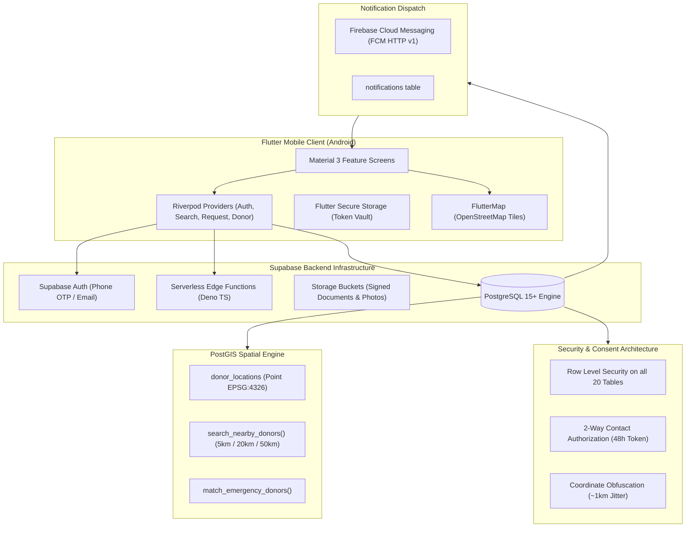

# 🩸 BloodBond Bangladesh
### *National Blood Donation Mobile Platform*
> **"Every Drop Connects a Life."**

[](https://flutter.dev)
[](https://supabase.com)
[](https://postgis.net)
[](#)

---

## 1. Executive Summary

**BloodBond Bangladesh** is a nationwide, enterprise-grade mobile platform architected to connect voluntary blood donors with patients in critical need across all **8 Divisions and 64 Districts of Bangladesh**. 

Unlike simple UI prototypes or unverified public spreadsheets, BloodBond implements:
- **Zero-Trust Privacy & Consent Architecture**: Voluntary donor mobile numbers and exact GPS coordinates are cryptographically guarded. Seekers must request explicit donor consent before contact is authorized.
- **PostGIS Geographic Engine**: Proximity-first searching prioritizing matches **within 5 km**, then expanding to 5–20 km and 20–50 km.
- **Automated Rest Period & Availability Workflow**: Following an officially verified blood donation, a donor is transitioned to `temporarily_unavailable` for 90 days. Once the 90-day cooldown expires, the system triggers an availability review (without falsely declaring clinical clearance).
- **Official Digital Donor ID**: Generates a verified digital card with scannable QR verification code (e.g. `BB-CTG-000001`), verification badge tiers (`verified_donor`, `star_donor`, `blood_champion`, `legend`), and tamper-proof verification endpoint.
- **Centralized Responsive Admin Panel**: Web-based command center for hospital verifiers, Red Crescent coordinators, and administrators to verify donations, moderate emergency alerts, and view spatial analytics.

---

## 2. Technology Stack

| Layer | Technologies |
|---|---|
| **Mobile App (Android/iOS)** | Flutter, Dart, Material 3, Riverpod 2.5+, GoRouter 14+ |
| **Backend & Auth** | Supabase Auth (Phone OTP, Email/Password, Google), PostgreSQL 15+ |
| **Spatial Engine** | PostGIS (`geometry(Point, 4326)`), ST_DistanceSphere, GIST Indexes |
| **Storage & Edge** | Supabase Storage (Signed URLs), Deno/TypeScript Edge Functions |
| **Push Notifications** | Firebase Cloud Messaging (FCM HTTP v1), Flutter Local Notifications |
| **Maps** | OpenStreetMap, FlutterMap, MapLibre |
| **Admin Web Portal** | HTML5, CSS3 Grid/Flexbox, JavaScript ES6+, Supabase JS, Chart.js |

---

## 3. High-Level Architecture



---

## 4. Repository & Codebase Structure

```text
bloodbond_bangladesh/
│
├── lib/
│   ├── main.dart                      # Bootstrap & Supabase initialization
│   ├── app.dart                       # MaterialApp.router with themes & locales
│   │
│   ├── core/
│   │   ├── config/app_config.dart     # Configurable Branding System & constants
│   │   ├── constants/                 # Bangladesh divisions, districts & blood matrices
│   │   ├── theme/app_theme.dart       # Material 3 light and dark themes
│   │   ├── router/app_router.dart     # GoRouter navigation & deep linking
│   │   ├── security/security_vault.dart # Android KeyStore token vault
│   │   ├── services/                  # Supabase, PostGIS Location & Notification services
│   │   └── utils/validators.dart      # Bangladesh phone & age eligibility validators
│   │
│   ├── features/
│   │   ├── onboarding/                # Intro carousel & value proposition
│   │   ├── authentication/            # Welcome, Login, Register, Phone OTP, Reset
│   │   ├── home/                      # Dashboard, emergency banner, blood needs ticker
│   │   ├── donor/                     # Donor registration, profile, 90-day review
│   │   ├── donor_search/              # PostGIS nearby search, filters, OpenStreetMap
│   │   ├── blood_request/             # Create request, emergency broadcast, tracking
│   │   ├── donation/                  # Donation history, official verification log
│   │   ├── donor_id/                  # Digital Donor ID card, QR code & scanner
│   │   ├── contact_consent/           # 2-way consent handshake, phone sharing
│   │   ├── reviews/                   # Verified interaction ratings (1-5 stars)
│   │   ├── notifications/             # Categorized notification feed
│   │   ├── organizations/             # Red Crescent, blood banks, hospital directory
│   │   ├── profile/                   # Multi-role user profile & management
│   │   └── settings/                  # Branding updates, language (বাংলা/EN), dark mode
│   │
│   └── shared/
│       ├── widgets/                   # BloodGroupBadge, DonorCard, SkeletonLoader
│       ├── models/                    # Typed models (UserProfile, DonorProfile, etc.)
│       └── providers/                 # Riverpod StateNotifiers & AsyncNotifiers
│
├── supabase/
│   ├── migrations/
│   │   ├── 20261112000001_initial_schema.sql         # 20 core tables + PostGIS extension
│   │   ├── 20261112000002_postgis_location_rpcs.sql   # search_nearby_donors & emergency matching
│   │   ├── 20261112000003_triggers_and_automation.sql # 90-day cooldown, badges, ID generator
│   │   ├── 20261112000004_rls_policies.sql           # Complete RLS on all 20 tables
│   │   ├── 20261112000005_storage_buckets.sql        # Storage policies & buckets
│   │   └── 20261112000006_seed_data.sql              # Bangladesh Red Crescent, settings, badges
│   │
│   └── functions/
│       ├── search-nearby-donors/index.ts
│       ├── match-emergency-donors/index.ts
│       ├── approve-contact-request/index.ts
│       ├── verify-donation/index.ts
│       ├── send-notification/index.ts
│       └── verify-donor-id/index.ts
│
├── admin_panel/                       # Responsive Web Admin Portal
│   ├── index.html                     # Dashboard, donors, verifications, analytics
│   ├── styles.css                     # Premium crimson/navy branding
│   ├── app.js                         # Realtime stats, Chart.js integrations
│   └── README.md                      # Deployment instructions
│
├── android/                           # Production Android Build Configuration
│   ├── app/src/main/AndroidManifest.xml # Permissions (Fine/Coarse GPS, Notifications, Camera)
│   ├── app/build.gradle               # compileSdk 34, minSdk 23, ProGuard rules
│   └── app/proguard-rules.pro
│
├── docs/                              # Production Documentation
│   ├── ARCHITECTURE.md
│   ├── SETUP.md
│   ├── SUPABASE.md
│   ├── DATABASE.md
│   ├── SECURITY.md
│   ├── NOTIFICATIONS.md
│   ├── ADMIN.md
│   ├── TESTING.md
│   └── ANDROID_BUILD.md
│
└── test/                              # Automated Test Suite
    ├── unit/blood_compatibility_test.dart
    ├── unit/validators_test.dart
    ├── unit/distance_and_tiers_test.dart
    ├── unit/availability_rules_test.dart
    └── security/privacy_security_test.dart
```

---

## 5. Getting Started

### Prerequisites
- Flutter SDK (v3.22+)
- Java JDK 17
- Android SDK (API 34)
- Supabase Project

### 1. Database Setup
Execute the migrations in `supabase/migrations/` in order into your Supabase SQL editor:
1. `20261112000001_initial_schema.sql`
2. `20261112000002_postgis_location_rpcs.sql`
3. `20261112000003_triggers_and_automation.sql`
4. `20261112000004_rls_policies.sql`
5. `20261112000005_storage_buckets.sql`
6. `20261112000006_seed_data.sql`

### 2. Configure Environment
Provide your Supabase credentials via `--dart-define`:
```bash
flutter run \
  --dart-define=SUPABASE_URL=https://your-project.supabase.co \
  --dart-define=SUPABASE_ANON_KEY=eyJhbGciOi...
```

### 3. Running the Test Suite
```bash
flutter test
```

### 4. Running the Admin Web Panel
```bash
python -m http.server 8080 --directory admin_panel
```

---

## 6. Building for Android Production

```bash
# 1. Build Universal Release APK
flutter build apk --release

# 2. Build Split-per-ABI Release APKs (Smaller download size)
flutter build apk --release --split-per-abi

# 3. Build Google Play Store Bundle (.aab)
flutter build appbundle --release
```

---

## 7. Security and Ethics Non-Negotiables

- **Service Role Key Isolation**: The Supabase Service Role Key is strictly confined to server-side Edge Functions and never embedded in client binaries.
- **Location Fuzzing**: Donor GPS coordinates are never displayed as raw coordinates. They are obfuscated to approximate 1km boundaries.
- **Two-Way Consent**: A donor's telephone number is only accessible when the donor explicitly reviews and approves the request.
- **Medical Eligibility Responsibility**: 90-day cooldown triggers availability review prompts; clinical blood fitness remains the official responsibility of certified phlebotomists at donation time.
