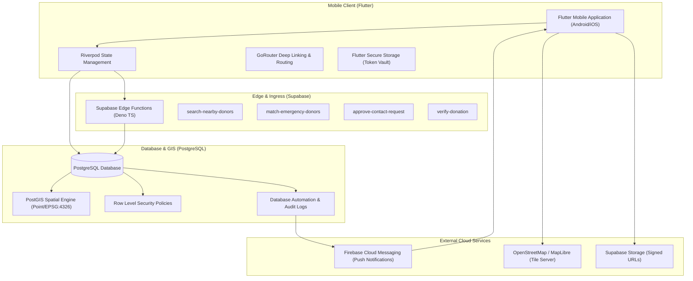

# BloodBond Bangladesh — System Architecture

## 1. High-Level Architectural Overview

BloodBond Bangladesh is architected as an enterprise, privacy-centric, nationwide mobile blood donation and matching platform. The system connects voluntary blood donors with seekers across all 8 divisions and 64 districts of Bangladesh.



---

## 2. Directory Structure & Feature-First Pattern

```text
lib/
├── main.dart                      # Entry point, dependency overrides, initialization
├── app.dart                       # MaterialApp.router, theme configuration
│
├── core/
│   ├── config/                    # App environment, Supabase constants, API keys
│   ├── constants/                 # Bangladesh divisions, districts, upazilas, blood types
│   ├── theme/                     # Material 3 light/dark themes, BloodBond palette
│   ├── router/                    # GoRouter configuration, auth guard routes
│   ├── security/                  # Obfuscation, permission validation, token storage
│   ├── services/                  # SupabaseClient, LocationService, FCMNotificationService
│   └── utils/                     # Formatters, validators, distance calculations
│
├── features/
│   ├── onboarding/                # Intro carousel, value proposition
│   ├── authentication/            # Phone OTP, Email/Password, Profile initialization
│   ├── home/                      # Dashboard, emergency blood radar, quick actions
│   ├── donor/                     # Donor profile, availability review, stats
│   ├── donor_search/              # PostGIS nearby search, Bangladesh administrative filters
│   ├── blood_request/             # Request creation (Emergency/Urgent/Normal), matching
│   ├── donation/                  # Donation history tracking, hospital slip verification
│   ├── donor_id/                  # Digital Donor ID card, QR verification payload
│   ├── contact_consent/           # 2-way consent handshake, contact access authorization
│   ├── reviews/                   # Verified interaction reviews (1-5 stars)
│   ├── notifications/             # FCM handling, categorized notifications
│   ├── organizations/             # Red Crescent, blood banks, hospital directory
│   ├── campaigns/                 # Blood drive campaigns, attendance registration
│   ├── profile/                   # Multi-role user profile, account settings
│   └── settings/                  # Branding configuration, language (EN/BN), theme toggle
│
└── shared/
    ├── widgets/                   # BloodGroupBadge, EmergencyAlertBanner, SkeletonLoader
    ├── models/                    # Typed data models (UserProfile, DonorProfile, BloodRequest)
    └── providers/                 # Riverpod StateNotifiers & AsyncNotifiers
```

---

## 3. Privacy-First Principles

1. **Obfuscated Geographic Coordinates**: Exact home coordinates are never stored in plain view or exposed over public RPCs. The PostGIS RPC returns jittered coordinates (`approx_latitude`, `approx_longitude`) rounded to ~1km.
2. **Consent-Based Contact Sharing**: Seekers can never directly read a donor's private phone number. A contact request must be explicitly approved by the donor.
3. **No Medical Eligibility Automation**: A donor is never automatically declared medically eligible. After the 90-day cooldown, the system prompts the donor with a review task.
