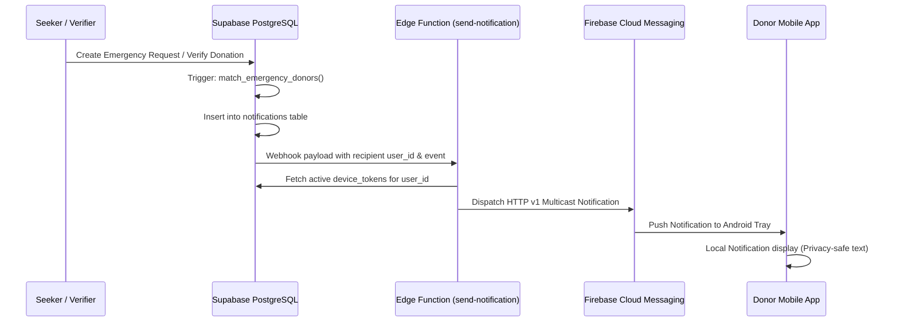

# BloodBond Bangladesh — Notification Engine & FCM Architecture

## 1. Notification Categories

```text
EMERGENCY_REQUEST     - 5km / urgent matching blood needed
MATCHING_REQUEST      - Non-emergency request matching donor profile
CONTACT_REQUEST       - Seeker requesting donor's phone number
DONOR_RESPONSE        - Donor expressed interest or declined
DONATION_VERIFIED     - Official verification of blood donation
AVAILABILITY_REVIEW   - 90-day cooldown rest period expired
REVIEW_RECEIVED       - Seeker posted feedback on completed donation
SYSTEM_ANNOUNCEMENT   - National blood drive announcement
```

---

## 2. Notification Pipeline



---

## 3. Privacy-Safe Notification Content

To prevent leaking sensitive patient health data or personal medical conditions on lock screens:

- **Emergency Alert**:
  > 🚨 *Emergency Blood Request*
  > *Matching O+ blood is urgently needed near your area. Open BloodBond to review details.*
- **Rest Period Notification**:
  > 🩸 *Availability Review Due*
  > *Your 90-day rest period is complete. Please review your availability before accepting new requests.*
- Lock screen notifications never display patient full name, exact room number, or clinical diagnostics.
